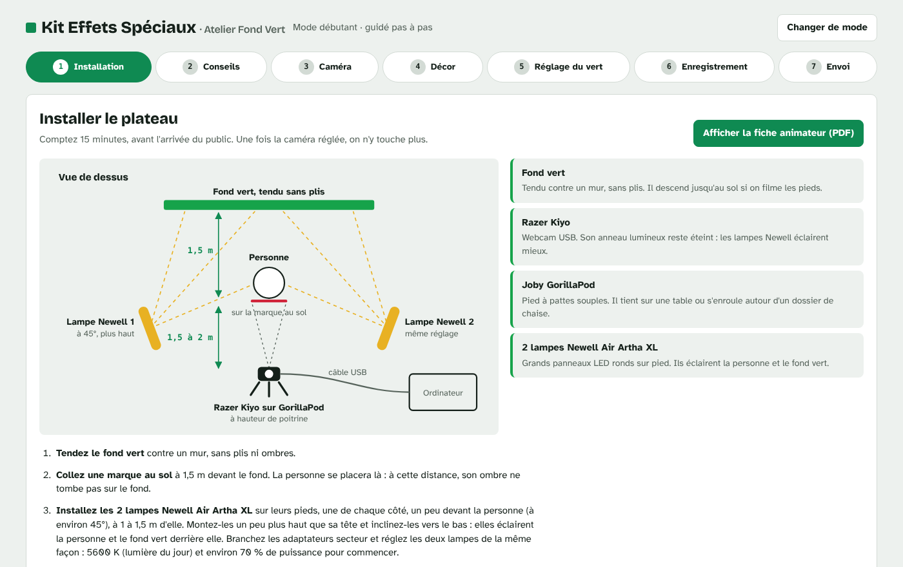
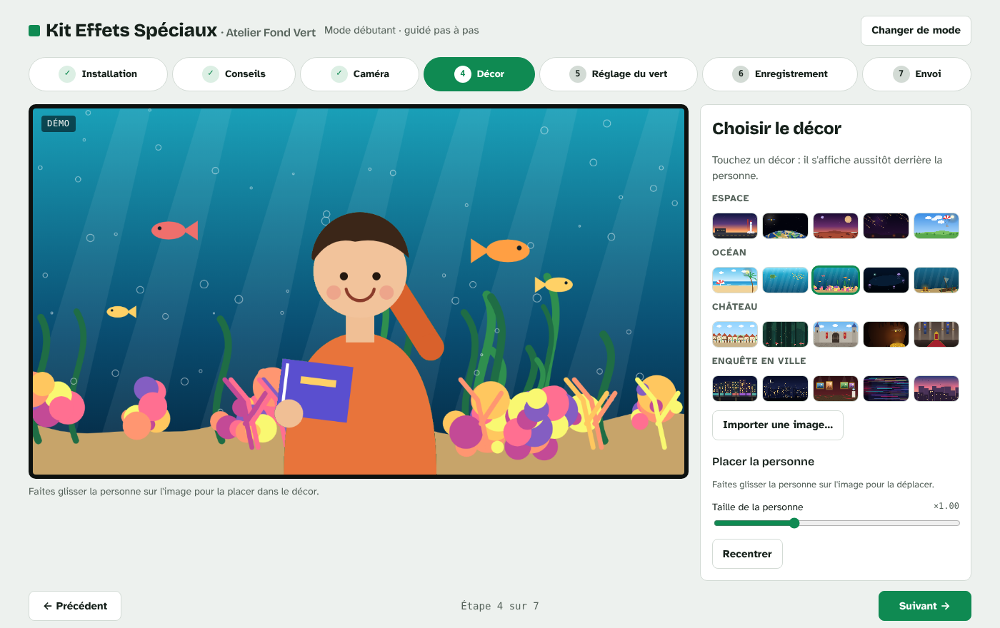
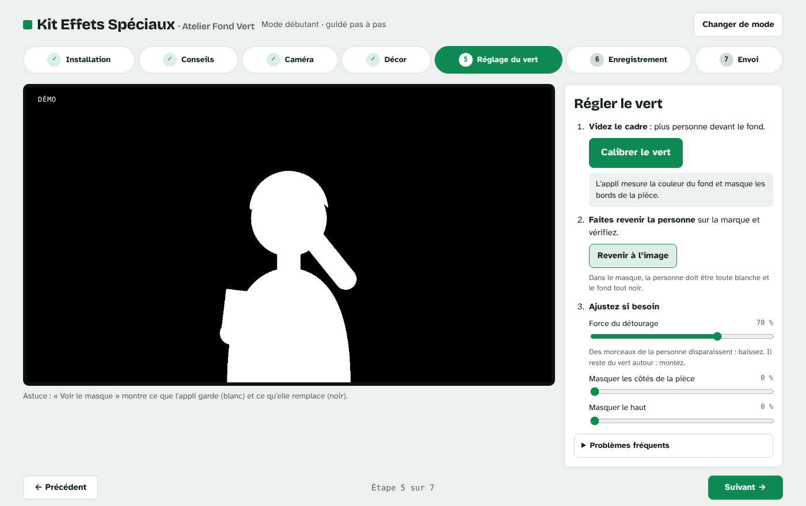
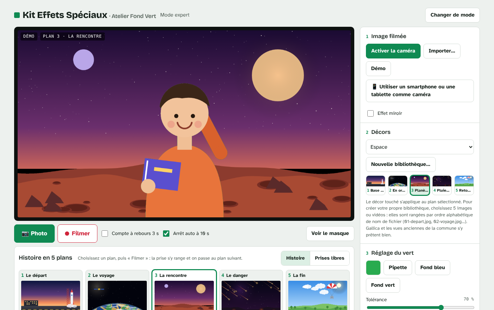

# Kit Effets Spéciaux - Atelier Fond Vert


| Mode débutant : installation du plateau | Mode débutant : choix du décor |
| --- | --- |
|  |  |
| **Mode débutant : réglage du vert** | **Mode expert : histoire en 5 plans** |
|  |  |

Appli d'incrustation sur fond vert en direct, conçue pour les ateliers numériques en bibliothèque. Les participants se voient dans un décor et repartent avec leur photo ou leur vidéo.

- **Version en ligne**, sans installation : https://bibliogironde.github.io/kit-effets-speciaux/
- **Application à installer** (macOS, Windows, Linux) : page [Releases](https://github.com/biblioGironde/kit-effets-speciaux/releases)

## Deux modes

| Mode | Pour qui | Contenu |
| --- | --- | --- |
| 1 · Débutant | Animateurs qui découvrent le fond vert | 7 onglets dans l'ordre de l'atelier : installation, conseils, caméra, décor, réglage du vert (calibrage automatique), enregistrement, envoi par email |
| 2 · Expert | Animateurs à l'aise | Tous les réglages, 4 bibliothèques de 5 décors, import de décors, histoire en 5 plans et montage automatique du film |

L'écran d'accueil donne aussi accès à l'**autorisation d'utilisation de l'image** à faire signer (PDF), et le mode débutant à la **fiche animateur** (PDF, 2 pages).

## Matériel prévu

- Un fond vert
- Une webcam Razer Kiyo, sur un pied Joby GorillaPod
- Deux lampes LED Newell Air Artha XL
- Un ordinateur avec Chrome (version en ligne) ou l'application installée

Un smartphone ou une tablette peut aussi servir de caméra : l'ordinateur affiche un QR code à flasher. Il faut pour cela une connexion Internet, et l'appli doit être ouverte depuis sa version en ligne (adresse en https).

## Installer l'application

L'application n'est pas signée numériquement.

- **macOS** : téléchargez le `.dmg` qui correspond à votre Mac (`arm64` pour les puces Apple M1 à M4, `x64` pour les Mac Intel). Au premier lancement, faites un clic droit sur l'application, puis « Ouvrir ». Autorisez ensuite l'accès à la caméra et au micro.
- **Windows** : choisissez la version d'installation ou la version portable. Si SmartScreen s'affiche, cliquez sur « Informations complémentaires », puis « Exécuter quand même ».
- **Linux** : rendez le fichier `.AppImage` exécutable (`chmod +x`), puis lancez-le.

## Organisation du dépôt

```
app/                 l'appli web (servie telle quelle par GitHub Pages et embarquée dans l'application)
  index.html         l'appli complète, sans dépendance en ligne
  fonts/             polices embarquées (Bricolage Grotesque, Atkinson Hyperlegible, licence OFL)
  vendor/            PeerJS (liaison smartphone) et qrcode-generator (licence MIT)
  *.pdf              fiche animateur et autorisation d'utilisation de l'image
electron/main.js     l'application de bureau
build/icon.png       icône de l'application
sources/             sources HTML des deux PDF
.github/workflows/   publication des releases et de la version en ligne
```

## Développement

```bash
npm install
npm start            # lance l'application de bureau
npm run dist:linux   # construit l'application pour Linux dans dist/
```

Pour tester la version web, ouvrez `app/index.html` dans Chrome.

Pour régénérer les PDF après une modification de `sources/`, imprimez le fichier HTML en PDF (format A4, sans marges, avec les arrière-plans).

## Publier une nouvelle version

Changez le numéro de `version` dans `package.json` (par exemple `1.1.0`) et poussez sur `main`.

Le workflow « Release de l'application » voit la nouvelle version, construit l'application sur macOS, Windows et Linux, puis crée le tag `v1.1.0` et la release avec les fichiers à télécharger. Tant que le numéro de version ne change pas, aucune release n'est créée.

La version en ligne se met à jour toute seule à chaque modification du dossier `app/` sur la branche `main`. Au tout premier déploiement, activez GitHub Pages dans **Settings > Pages**, avec la source « GitHub Actions ».
